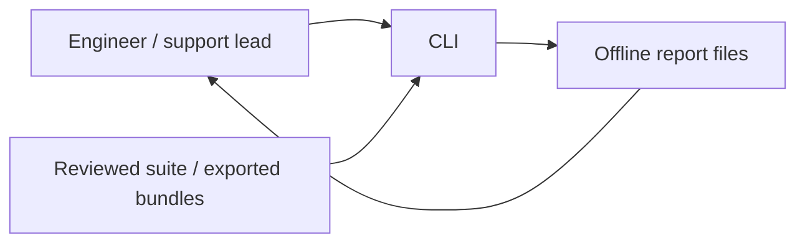
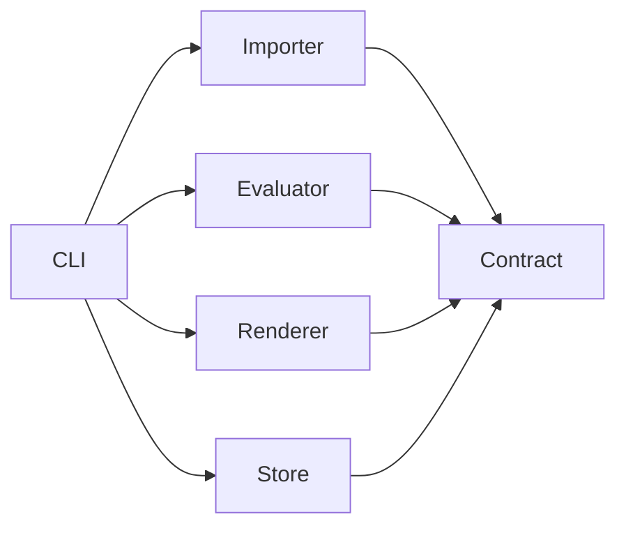

# Solution Design Document

Planning baseline merged in [PR #6](https://github.com/Himanshu-singh04/releaselens/pull/6).
The [B0 research](../../decisions/001-runtime.md) was conditionally accepted in PR #11;
tested pins and M0 closure remain blocked. The [B0a storage protocol](../../decisions/002-storage-protocol.md)
documentation was accepted in PR #13, including R1; its requirement proposals remain
unadopted; customer implementation remains NO-GO and no test target or E1 is authorized.
The founder adopted N1–N4, conditional runtime direction, synthetic-terminal scope/sequence
and AI deferral; [B0d](../../decisions/005-adopted-policy-reconciliation.md) records exact authority
and this pending normative reconciliation. Enforcement is unverified. The synthetic exception
does not itself authorize implementation or close M0/M1–M4; D1–D4 remain unadopted.
Product components, callable interfaces, directories and runtime qualification remain nonexistent.
Template headings are retained verbatim, including bracketed example headings.

## Validation Checklist

### CRITICAL GATES (Must Pass)

- [x] Required sections contain a draft design or explicit N/A.
- [x] No unresolved clarification placeholders in section bodies; decisions are explicit ADRs.
- [x] Architecture pattern and proposed interfaces are described.
- [ ] All architecture gates closed: B0 research accepted, but unresolved validation and requirement decisions remain.
- [ ] Implementation readiness: synthetic slices need the adopted scoped prerequisites and separate permission; customer gates remain blocked.

### QUALITY CHECKS (Should Pass)

- [x] Context sources, actual foundation commands, boundaries, and requirement mapping documented.
- [x] Components, data lifecycle, errors, and measurable proposed targets specified.
- [x] B0 research review/approval recorded in PR #11 merge verification; not implementation readiness.
- [x] B0a documentation reviewed and approved in PR #13; D1–D4 and E1 remain unaccepted/unauthorized.
- [ ] Runtime/SDK compatibility, resource measurements, and product validation not performed.

## Constraints

CON-1 Agreed: independent local-first product; zero new initial hosting/inference expenditure.
CON-2 Agreed: imported evidence is data; missing evidence is unknown; requests are not effects.
CON-3 Current: repository contains foundation checks, not application code or runtime manifests.
CON-4 Current: source/docs and worker history/OpenAI OAuth are on the pendrive; Mac CPU/RAM
executes processes. Coordinator history/App key remain on Mac; see [operations](../../operations.md).
Worker provisioning does not establish product-private I/O: the observed pendrive is noowners.
CON-5 Adopted: bundled synthetic terminal demo first under the roadmap exception; no agent execution.
Customer imports/publication remain gated; no customer/path input, Store or persistence in the demo.
CON-6 Proposed/unmeasured: bounded data and offline reports within [contract](../../evidence-contract.md) limits.

## Implementation Context

### Required Context Sources

#### Documentation Context

| Source read | Relevance | Why |
| --- | --- | --- |
| [Issue #5](https://github.com/Himanshu-singh04/releaselens/issues/5) | CRITICAL | A1–A7 and documentation-only authorization. |
| [AGENTS](../../../AGENTS.md), [contributing](../../../CONTRIBUTING.md) | CRITICAL | Data boundaries, existing commands, contribution policy. |
| [Development](../../development.md), [foundation](../../foundation.md) | CRITICAL | Delivery evidence, review ownership, actual bootstrap state. |
| [PRD](../../product.md), [contract](../../evidence-contract.md) | CRITICAL | Requirements and authoritative proposed shapes/semantics. |
| [Roadmap](../../roadmap.md), [testing](../../testing.md), [operations](../../operations.md) | HIGH | Milestones, verification, storage/recovery. |
| [README](../../../README.md) | HIGH | Public status and navigation; must not imply product availability. |
| Architecture skill template.md and validation.md, local OpenCode configuration | HIGH | Required section order and design-validation criteria; reviewed 2026-11-18. |
| [RFC 8785](https://www.rfc-editor.org/rfc/rfc8785) | HIGH | Canonical JSON hashing, duplicate-key/Unicode restrictions; informational specification. |
| [RFC 6901](https://www.rfc-editor.org/rfc/rfc6901.txt) | HIGH | Exact JSON Pointer reference semantics and resolution errors. |
| [B0 runtime recommendation and source register](../../decisions/001-runtime.md) | CRITICAL | #10 runtime comparison, exact version-specific sources retrieved 2026-11-19, observations, native API gaps and ADR disposition. |
| [B0d authority and reconciliation](../../decisions/005-adopted-policy-reconciliation.md) | CRITICAL | #18; exact adopted B0c numeric/scope clauses, pending enforcement, unadopted D1–D4 and retained customer gates. |

External sources constrain proposals, not prove local installation or compatibility. Recheck
runtime support before pinning. No model-serving behavior is assumed without a later primary-source review.

#### Code Context

| File read | Relevance | Implication |
| --- | --- | --- |
| [scripts/check_repository.py](../../../scripts/check_repository.py) | HIGH | Checks tracked text and relative file links only; excludes untracked drafts and anchors. |
| [.github/workflows/ci.yml](../../../.github/workflows/ci.yml) | HIGH | Existing foundation/PR checks; no product build or inference. |
| [.gitignore](../../../.gitignore) | HIGH | Local evidence, models, caches, and session databases excluded from Git. |

Application code context: N/A; no package manifest, product schemas, fixtures, or modules exist.

#### External APIs (if applicable)

N/A for MVP runtime. GitHub supports development delivery only; evidence import does not call
GitHub, vendors, customer agents, model providers, or business systems. Future adapters need separate contracts.

### Implementation Boundaries

- Must preserve: foundation checks, human review, independent product, and zero-spend constraint.
- Can modify for B0d/#18: normative Markdown for adopted numeric/synthetic scope and necessary status/navigation links.
- Must not touch now: fixture definitions/encoding, source, experiments, installs, deployment, credentials or provisioning.
- B1 source-only definitions may precede M0 after reviewed schema adoption, this reconciliation's merge and separate authorization.
- Later separately authorized pure Contract/Evaluator/terminal-renderer slices need scoped runtime/JCS/new N2/N4 validation;
  they may precede native storage/full packaging only for bundled reviewed synthetic inputs. No customer/path imports,
  Store, persisted report or release package. M0/M1–M4 stay incomplete; all customer gates still apply.
- No waiver of the 60-second deadline: terminal-I/O/scheduling enforcement remains unresolved; return conflicts before implementation permission.

### External Interfaces

#### System Context Diagram



This diagram describes the later customer path. The synthetic lane instead selects bundled
reviewed inputs, compares in memory and displays a terminal table, with no Files-path import or Store.
Files and Report are local data, Operator is external; CLI maps to src/cli below.
The support agent and business system export data outside this boundary; there is no execution arrow.

#### Interface Specifications

Customer-path proposed/nonexistent CLI grammar: `releaselens compare --suite FILE --baseline FILE
--candidate FILE --out NEW_DIRECTORY`. Exactly one value per required flag; unknown/repeated
flags fail. No implicit discovery, configuration search, environment credentials, or network.
Inputs are regular nonsymlink files; output must be a new directory under an explicitly
selected existing nonsymlink parent. Require verified owner-private directories/files
(0700/0600 or validated equivalent), ownership/ACL and mount-capability preflight, and an
empty probe before evidence writes; chmod success alone is insufficient. Unsupported access
control refuses publication. [Operations](../../operations.md) specifies pinned-handle mount/
directory identity enforcement through reads, writes, and marker publication; no path fallback.
Outputs: report.json, report.html, completion marker; schemas and hashes in the contract.
stdout: one JSON summary `{status:"pass"|"fail"|"unknown",result_hash:Hash,output_path:string}`
only after complete publication; status aggregates all expected candidate cases.
stderr: Diagnostic JSON lines with tagged input/argument locations or null, per the contract;
no raw evidence, argument values, paths, or OS exception text. Proposed exit codes:
0 candidate pass; 1 candidate fail; 2 usage/input/integrity error; 3 candidate unknown;
4 I/O/resource/internal failure. Fatal error takes precedence; then fail, unknown, pass.
N/A: HTTP endpoints, auth tokens, webhooks, billing, or database connections.

Adopted synthetic interface scope: select the bundled example with fixed baseline/candidate;
display eight reviewed rows (including missing/changed), both outcomes, delta, reason, citations
and expected-suite coverage, escaping terminal control characters. No user-supplied paths or
customer evidence. This is not the customer publication summary with output_path above.
No executable demo command/grammar exists or is authorized here. Terminal display does not
fulfill RL-008/011; immutable Report/marker shapes and the customer failure contract stay intact.

### Cross-Component Boundaries (if applicable)

One product owner and one future package, with pure evaluation separated from filesystem I/O.
The contract is the only public data boundary; internal APIs remain package-private.
Major contract changes require explicit conversions and fixtures; no silent compatibility.
No shared runtime/database/service with other portfolio projects.

### Project Commands

Only existing commands, copied from CONTRIBUTING.md (Git, Python 3.11+, actionlint 1.7.12):

```sh
python3 scripts/check_repository.py
python3 -m unittest discover -s scripts -p 'test_*.py'
actionlint -shellcheck= -pyflakes=
git diff --check
```

Install/dev/build/migrate/seed/product-test commands: N/A; none exist. The CLI grammar above
is a design proposal, not a runnable instruction. Future commands must enter CONTRIBUTING first.

## Solution Strategy

Retain a modular CLI for the customer path: explicit imports, pure evaluator, immutable results
and static offline renderer. The synthetic lane exercises pure Contract/Evaluator and a terminal
renderer before customer Store, under the explicit prerequisites above. The adopted conditional
direction from [B0](../../decisions/001-runtime.md) is CPython 3.14.10 standard GIL with rfc8785
0.1.4; the customer Store needs a narrow Darwin bridge. The earlier
TypeScript/Node proposal remains a compared alternative. The native bridge stays in Store;
no new service is proposed. Compatibility, storage guarantees and deadline enforcement
remain blocked. This retains inspectable evidence at the cost of manual export preparation
and narrow semantics; no hosting or inference is needed.
No database is needed for bounded immutable comparisons; files simplify portability but
make concurrent editing and large datasets deliberately unsupported. AI deferral beyond
deterministic/pilot gates is adopted; no AI runtime/model or implementation is authorized.

## Building Block View

### Components



CLI orchestrates only. Importer owns parsing/integrity; Evaluator owns alignment/assertions;
Renderer owns safe presentation; Store owns publication; Contract owns types/version constants.
No component invents evidence, and Renderer cannot re-evaluate or change a verdict.
This is the customer dependency graph. The synthetic lane omits Importer/Store I/O and uses
only bundled validated values through Contract/Evaluator and terminal presentation in Renderer.

### Directory Map

All paths proposed, none created by this documentation task. These are logical component
locations; Python package layout is not frozen while ADR-1/4 remain blocked:

| Component | Directory | Responsibility / requirements |
| --- | --- | --- |
| CLI | src/cli | Explicit inputs, deadlines, exit status; RL-010, RL-012. |
| Importer | src/import | Bounded reads, schema/reference/hash checks; RL-001, RL-002, RL-003. |
| Contract | src/contract | Shapes and canonical identity helpers; RL-001, RL-003, RL-009. |
| Evaluator | src/evaluate | Pure alignment, rule outcomes, aggregation; RL-004, RL-005, RL-006, RL-007, RL-009. |
| Renderer | src/report | Customer HTML/JSON (RL-008); separately scoped inert terminal presentation for the demo. |
| Store | src/storage | New generation, file digests, completion marker; RL-011. |

fixtures/ would hold reviewed synthetic data; tests/ would cover the [test matrix](../../testing.md).
Later AI work would require a separately reviewed src/explain boundary; it is not in this MVP diagram.

### Interface Specifications

#### Interface Documentation References

[Evidence contract](../../evidence-contract.md), CRITICAL: Suite, Bundle, Run, Event, Ref,
Result, Report, namespace-qualified Citation resolution, provenance, bounds, and aggregation.
It is authoritative over illustrative prose; embedded suites and bundle artifacts are distinct namespaces.
[Operations](../../operations.md), HIGH: publication lifecycle, sensitive inputs, recovery.

#### Data Storage Changes

N/A for database changes. Proposed files: explicit reviewed suite, two immutable input bundles,
and a new output generation with three files. Store does not copy inputs to a global cache.
Report snapshots deliberately duplicate bounded imports for offline audit. No search index.
The synthetic demo has no persisted report/generation; that scope does not change customer storage.

#### Internal API Changes

Proposed package-private interfaces; all failures return `{ok:false,error:Diagnostic}`:

| Operation | Input | Success `{ok:true,value:...}` |
| --- | --- | --- |
| Store.prepare | Three explicit input paths, new output path | Opaque IoContext with retained verified handles/identities and destination privacy preflight; no evidence written. |
| Importer.load | IoContext, fixed limits | Validated Suite/Bundles, exact byte hashes read from the pinned files; never partial imports. |
| Evaluator.compare | Validated Suite, baseline Bundle, candidate Bundle, evaluator_version | Result; no I/O, clock, randomness, or model calls. |
| Renderer.render | Report | UTF-8 JSON/HTML bytes after exact observed-reference citation binding checks; escaped evidence, no active content. |
| Store.publish | Same IoContext, rendered bytes | Absolute output_path and marker hashes after private-access/mount-identity revalidation. |

CLI creates generated_at once after evaluation, packages Report, renders, publishes, then
emits status. IoContext is private process state, never imported JSON; CLI retains it across
stages and releases handles on all exits. Contract's H helper has conformance tests planned.
N/A: OpenAPI specification, internal HTTP endpoints, cross-process RPC.

Those Store/Importer/Report interfaces remain customer-only. Future synthetic calls use bundled
validated Suite/Bundles and the same pure Evaluator.compare Result semantics. Terminal rendering
uses those values and namespace-qualified citations to display escaped inert text, without
publishing Report bytes or invoking Store. It may not change verdicts. Exact callable packaging
belongs to a later authorized slice; no new callable interface or implementation exists here.

#### Application Data Models

Suite defines reviewed expectations; Bundle preserves an export and suite snapshot; Run
records one case attempt; Event preserves request/completion/effect distinctions. Artifact
supplies source-bound bytes; Ref selects exact evidence. Result derives outcomes and coverage;
Report adds timestamp, byte hashes, and snapshots. All fields are specified in the contract.

#### Integration Points

In the customer path CLI passes validated values in memory. Only Importer reads source files;
only Store writes output. Renderer consumes the computed Result, never source HTML templates.
No external integration SDK selected. Export adapters and model runtimes remain gated later work.

### Implementation Examples

These are behavioral examples, not created code or runnable fixtures.

#### Example: [Complex Business Logic Name]

One refund case has value=pass, effect=unknown: case unknown. Add a supported policy failure:
case fail with one unknown still counted. Baseline pass and candidate unknown is incomparable
coverage loss, not unchanged. Baseline fail and candidate fail is unchanged but still a failure.

#### Example: [Integration Pattern Name]

A completed refund call with only a success message lacks business evidence. An eligible
snapshot must bind observed subject and value to direct members of one selected record object;
observed subject must agree with rule/request/effect. A valid order-8 refund cannot verify
order-7; selecting sibling records through root-level multi-token selectors stays unknown.
Resolved transcript/tool-return refs are structurally valid but ineligible (unknown), while
malformed/dangling refs or malformed/unresolved member selectors reject import. Missing selectors stay unknown.

#### Test Examples as Interface Documentation

Planned golden vectors in T-01 through T-06 exercise both examples and exact report shapes.
Tests are planned, not present. Fixture reviews must identify expected outcomes independently
of the evaluator, so snapshots cannot merely bless implementation output.

## Runtime View

### Primary Flow

#### Primary Flow: [Main User Action]

Synthetic path: select bundled fixed baseline/candidate; validate against the adopted contract;
compare in memory; display outcomes/deltas/reasons/citations/coverage with control characters
escaped. No path import, Store, persistence, agent or model call. Subject/value evidence must
bind to the same eligible record; request-only and missing negative observations stay unknown.
Customer flow (separately gated):

1. Engineer supplies reviewed suite and baseline/candidate exports with a new output location.
2. CLI validates arguments; Store prepares pinned/private I/O; Importer bounds reads and validates inputs.
3. Evaluator aligns each expected case and applies tri-state rules without side effects.
4. CLI packages snapshots; Renderer produces identical semantic results in JSON and HTML.
5. Store verifies private access and pinned identities across writes and around final marker publication.
6. CLI emits completion and candidate status; lead reads report and makes their own decision.

### Error Handling

The customer publication behaviors below remain unchanged; the demo cannot create a marker
or claim publication success. Fatal errors do not become comparison passes, and the original
resource/deadline obligation remains for both scopes. D3/D4 replacements are unadopted.

| Class / code | Behavior and recovery |
| --- | --- |
| Usage / E_USAGE | Exit 2; tagged zero-based argument index, or null for absent required option; fixed message without echoing tokens. |
| Parse/schema/version / E_SCHEMA | Exit 2; bounded location diagnostic; correct producer export. |
| Hash/reference/identity / E_INTEGRITY | Exit 2; reject entire comparison; preserve original input. |
| Different suite_id / E_SUITE | Exit 2; select correct suite/bundles; do not fuzzy-match. |
| Missing/stale/type/ineligible evidence | Complete report with unknown reason; obtain better evidence. |
| Rule mismatch | Complete report with fail; review agent/policy; not a parser error. |
| Imported error/timeout/skipped run | Unknown outcomes and explicit run state; export a new run. |
| Limits/deadline / E_LIMIT | Exit 4; no complete marker; split suite by reviewed scope. |
| I/O/mount/disk/permission / E_IO | Exit 4; null location if unlocatable; no success or path fallback. Preserve partial generation; retry only after verified recovery. |
| Unexpected implementation defect / E_INTERNAL | Exit 4; sanitized diagnostic, no successful report. |

Network failures: N/A for MVP; network access is not part of comparison. No automatic retries
of imports or tool calls; a rerun is explicit and cannot overwrite a complete generation.

### Complex Logic (if applicable)

Importer rejects invalid references before missing-evidence logic. Evaluator iterates the
reviewed expected set, not the intersection of bundles, then separately lists extras.
Matching case_hash is required for comparable outcomes; stable IDs alone are insufficient.
The contract defines exact aggregation, reason precedence, subject/time eligibility, and
evaluated coverage `(pass + fail)/expected` at case/assertion levels. Separate evidence coverage
is deferred; show unknown and defined assertion evidence-gap reason counts without a new ratio.

## Deployment View

### Single Application Deployment

Customer-path local CLI execution would use the observed arm64 Mac with a separately authorized external
owner-enabled APFS target; none is currently authorized/provisioned. Internal Mac storage is
not selected. Other platforms require separate proof. [B0](../../decisions/001-runtime.md) recommends CPython
3.14.10 and candidate rfc8785 0.1.4 for validation, not tested pins. Native bridge/build and
installer versions remain gated; the currently noowners pendrive is not a valid product target.
No required secrets/environment service. Explicit paths keep evidence and outputs local.
No package publication, installer, signed binary, server, or deployment currently exists.
Conditional target is standard-GIL CPython 3.14.10/rfc8785 0.1.4, uninstalled/unqualified as
a product stack; local 3.13.4/CI 3.14.4 do not qualify it. Public synthetic source can remain
on the checkout under the adopted exception, without authorizing customer I/O on noowners.

### Multi-Component Coordination (if applicable)

N/A: one package, no distributed deployment. Schema/evaluator versions travel in reports.
Rollback selects an older compatible package and original inputs, producing a new generation;
never reinterpret a newer schema or rewrite the old report. AI remains disabled by absence.

## Cross-Cutting Concepts

### Pattern Documentation

Existing: [development](../../development.md), CRITICAL, exact delivery evidence and review.
Proposed: [contract](../../evidence-contract.md), CRITICAL, immutable provenance/tri-state rules;
[testing](../../testing.md), HIGH, independent expected outcomes and deterministic replay.

### User Interface & UX (if applicable)

Synthetic terminal: fixed example, eight reviewed rows, both outcomes/deltas/reasons/citations/
coverage; escape control characters. Future acceptance requires ten identical Result hashes
and independent explanation of regression/coverage loss without author interpretation.
Record failed explanations; no usability/demand claim follows from adoption.

Offline report order: candidate status and scope, failures/unknowns, evaluated coverage and
evidence-gap counts, changed sources,
case comparison, then evidence details. Text labels accompany colors; no percentage-only badge.
Proposed accessibility: semantic headings/tables, keyboard-readable links, sufficient contrast,
no script dependency. N/A: account navigation, design-system framework, live web state.

#### UI Visualization Guide

```text
ReleaseLens | imported evidence only | evaluator + input hashes
Candidate: UNKNOWN | 20 expected | 17 pass | 0 fail | 3 unknown
Coverage loss: 2 | changed definitions: 1 | extra cases: 1
Case | baseline | candidate | delta | reason | evidence
refund-7 | pass | unknown | incomparable | missing effect | refs
```

Illustrative values only. CLI states: validating → comparing → publishing → complete;
fatal errors exit without a complete marker. Static HTML needs no client-side state machine.

### System-Wide Patterns

Data-only parsing, escaped rendering, no embedded executable HTML/JS, no remote resources,
no credential lookup, and no telemetry. Customer I/O requires verified owner-private access;
it is not encryption or protection from privileged/same-account access.
Log only counts, IDs, versions, reason codes, and durations; even IDs can be sensitive.
English UI initially; preserve original Unicode evidence without localization transformations.
Bounded single-process evaluation avoids background workers; performance targets require measurement.

### Multi-Component Patterns (if applicable)

N/A for distributed consistency, service discovery, circuit breakers, or tracing infrastructure.
In-process immutable values and bundle/result hashes correlate stages. No global mutable verdict state.

## Architecture Decisions

B0 research/direction was accepted in PR #11; the entries below track remaining architecture
gates, not a request to reapprove that research. The [B0a protocol](../../decisions/002-storage-protocol.md)
records unadopted D1–D4 and untested storage obligations. B0d records the later numeric and
synthetic-only decisions; no whole-ADR/product-readiness approval follows. Pure work has the
scoped exception/prerequisites above; customer runtime/storage work retains full gates.
The original hard deadline remains unverified, including blocked terminal I/O; do not infer D4.

- [ ] ADR-1 Runtime/package: **conditional direction adopted**, CPython 3.14.10 standard GIL /
  rfc8785 0.1.4 per [B0](../../decisions/001-runtime.md); **unqualified** pending scoped JCS/new N2/N4
  validation, plus native-storage/build qualification for the customer package.
  Python reduces tooling and exposes dir_fd operations; Node 26.13.1 has easier ECMAScript
  serialization but a larger native I/O gap. Direction confirmed; tested pins/installation authority **not granted**.
- [ ] ADR-2 Storage/identity: propose JSON snapshots, RFC 8785 + SHA-256, explicit references,
  immutable reports instead of SQLite. Easy inspection/offline portability; larger duplicated
  files and bounded scale. N1–N4 **adopted**, including replacement N2 normalization; parser/JCS
  conformance/new N2/N4 validation remain **blocked**. Other storage/identity gates remain open;
  the numeric decision is not approval of D1–D4 or full ADR closure.
- [ ] ADR-3 Evaluation/authority: propose exact tri-state rules, pinned business sources,
  reviewed-suite denominator, no live execution. Avoids false certainty; manual exports and
  exporter authenticity remain user responsibilities. **Recommended**, no semantics change.
  Synthetic semantic scope confirmed; customer readiness/complete ADR closure remain pending.
- [ ] ADR-4 Packaging/resources: propose local package, static HTML/JSON, contract bounds,
  60-second deadline and no hosted service. Low operating cost; slower onboarding and no
  shared dashboard. **Blocked**: B0's noowners mount observation and unproven native bridge,
  effective-access, mount-race/publication and deadline guarantees prevent readiness.
  Unsupported volumes fail closed; T-09 remains required. Terminal-only scope/sequence confirmed;
  customer packaging/resources and hard-deadline enforcement remain unresolved.
- [x] ADR-5 AI/agent boundary: **deferral adopted** beyond deterministic/pilot gates. Later compare
  local runtime/model candidates or existing customer-owned inference at zero incremental
  founder cost; no model/runtime, license, quantization, context window, or capability selected.
  Only the MVP deferral is resolved; later investigation/implementation retains its separate gate.
  Grounded explanations may help triage but add nondeterminism and evaluation work. No agent
  business authority; any expansion requires a new approved ADR. User confirmed: **deferral only**.

## Quality Requirements

Adopted demo criteria and retained customer targets are unmeasured. Q1: identical Result hashes across 10 identical runs
(T-06). Q2: no missing-evidence pass in reviewed negative corpus (T-03/04/05). Q3: 100-case,
10-assertion/case, <=10 MiB total input comparison <=10 seconds and <=512 MiB peak RSS in
10 trials on the observed Mac (T-08); record cold/warm disk conditions, not just averages.
Q4: enforce contract limits/60-second deadline with no complete partial report (T-08/09).
Q5: zero outbound requests and zero script execution during comparison/report inspection
(T-07). Q6: first synthetic comparison <=15 minutes, triage <=10 minutes in four of six
pilot sessions (T-10). Q7: costs $0 new hosting/inference (T-12); no paid CI expansion.

## Acceptance Criteria

- [ ] Synthetic demo only: eight reviewed bundled rows including missing/changed, fixed baseline/
  candidate, escaped terminal outcomes/deltas/reasons/citations/coverage; ten identical Result hashes
  and independent explanation of regression/coverage loss. Full customer criteria below remain open.
- [ ] WHEN a reviewed suite is supplied, THE SYSTEM SHALL validate identity, sources, hashes,
  and reference integrity before evaluating (RL-001, RL-002, RL-003; T-01/02).
- [ ] IF evidence is insufficient, THEN THE SYSTEM SHALL preserve unknown and distinguish
  tool request, completion, and eligible same-record subject/value evidence (RL-004, RL-005; T-03/04).
- [ ] WHEN comparing imports, THE SYSTEM SHALL retain every expected case and expose
  missing/changed/extra cases and candidate failures (RL-006, RL-007; T-05).
- [ ] WHEN output completes, THE SYSTEM SHALL provide offline evidence-backed HTML/JSON
  with exact namespace-qualified citations, evaluated coverage, defined evidence-gap counts,
  and deterministic semantic identity (RL-008, RL-009; T-06/07).
- [ ] WHILE importing/rendering, THE SYSTEM SHALL treat all input as bounded inert data
  and publish only complete generations (RL-010, RL-011; T-07/08/09).
- [ ] THE SYSTEM SHALL support documented local recovery without new inference/hosting
  spend (RL-012; T-09/10/12).
- [ ] WHERE future AI is enabled after approval, THE SYSTEM SHALL cite evidence, abstain
  when unsupported, and remain within reviewed authority (RL-013, RL-014; T-11).

## Risks and Technical Debt

### Known Technical Issues

No product defects can be measured before implementation. Design risks: forged exports,
misleading source labels, incomplete traces, contradictory policy versions, and narrow rules
that miss semantic regressions. Hash integrity cannot cure these; pilot review must expose them.

### Technical Debt

No inherited application debt. Proposed deliberate limitations: manual import format,
single attempt/case, no incremental store, exact string rules, and no multi-user workflow.
Revisit only with measured pilot friction; avoid premature SDK/vendor abstractions.

### Implementation Gotchas

Reject duplicate JSON keys before ordinary parsing loses them. Null evidence differs from a
reference to a null JSON value. Case hashes bind referenced source metadata, not only text.
Apply N1/N3 rejection then replacement N2 normalization before numeric type checks, hashing or
Scalar equality across expected/actual, subjects and integer fields; true is not 1. N4 counts
raw token bytes and decoded artifact-array totals separately. B0b's lexical N2 tests are historical.
Filesystem rename/flush behavior on the mounted volume needs verification; a marker is not
a backup. Redaction changes hashes. Sorting report rows must not reorder source event arrays.

## Glossary

### Domain Terms

| Term | Definition | Context |
| --- | --- | --- |
| Baseline / candidate | Imported outputs before / after a change | No live execution implied. |
| Verified effect | Rule satisfied against eligible imported business evidence | Exporter authenticity remains unverified. |
| Unknown | Insufficient eligible evidence for a verdict | Never counted as pass. |

### Technical Terms

| Term | Definition | Context |
| --- | --- | --- |
| JCS | RFC 8785 JSON Canonicalization Scheme | Semantic content hashing. |
| Generation | New immutable report directory | Completion marker identifies finished output. |

### API/Interface Terms

| Term | Definition | Context |
| --- | --- | --- |
| Ref | Artifact ID plus exact JSON pointer or text selector | No network/path dereference. |
| Proposed CLI | Unimplemented command grammar | Not an available project command. |
