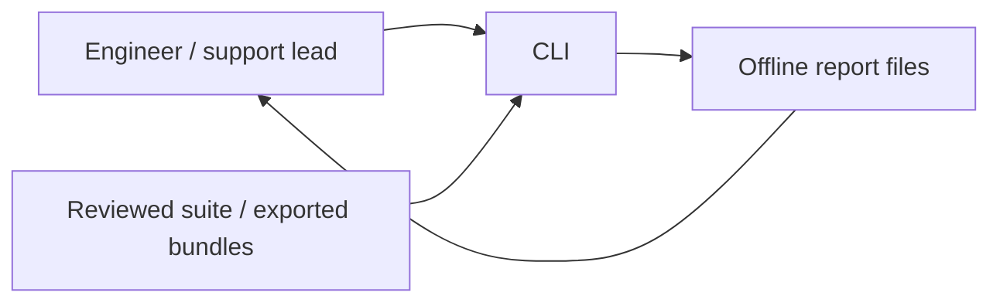
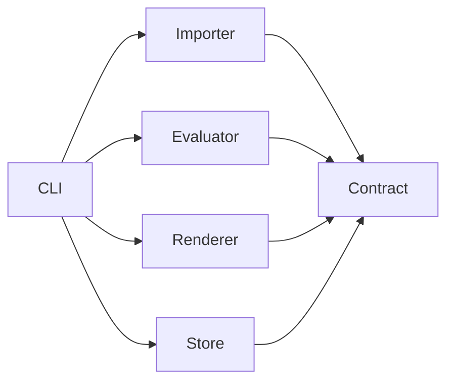

# Solution Design Document

Draft for documentation-PR confirmation, not approved architecture or permission to implement.
All product components, interfaces, directories, and targets below are proposed/nonexistent.
Template headings are retained verbatim, including bracketed example headings.

## Validation Checklist

### CRITICAL GATES (Must Pass)

- [x] Required sections contain a draft design or explicit N/A.
- [x] No unresolved clarification placeholders in section bodies; decisions are explicit ADRs.
- [x] Architecture pattern and proposed interfaces are described.
- [ ] All architecture decisions confirmed by user: ADR-1 through ADR-5 remain pending.
- [ ] Implementation readiness: blocked until owner decisions resolve these gates.

### QUALITY CHECKS (Should Pass)

- [x] Context sources, actual foundation commands, boundaries, and requirement mapping documented.
- [x] Components, data lifecycle, errors, and measurable proposed targets specified.
- [ ] Independent coordinator consistency review and exact-revision owner confirmation pending.
- [ ] Runtime/SDK compatibility, resource measurements, and product validation not performed.

## Constraints

CON-1 Agreed: independent local-first product; zero new initial hosting/inference expenditure.
CON-2 Agreed: imported evidence is data; missing evidence is unknown; requests are not effects.
CON-3 Current: repository contains foundation checks, not application code or runtime manifests.
CON-4 Current: source/docs are on the pendrive; Mac CPU/RAM executes processes. Current history,
credentials, and unconfigured model/cache routing are detailed in [operations](../../operations.md).
CON-5 Proposed: deterministic fixtures/imports first, one local process, no agent execution.
CON-6 Proposed/unmeasured: bounded data and offline reports within [contract](../../evidence-contract.md) limits.

## Implementation Context

### Required Context Sources

#### Documentation Context

| Source read | Relevance | Why |
| --- | --- | --- |
| [Issue #5](https://github.com/Himanshu-singh04/releaselens/issues/5) | CRITICAL | A1–A7 and documentation-only authorization. |
| [AGENTS](../../../AGENTS.md), [contributing](../../../CONTRIBUTING.md) | CRITICAL | Data boundaries, existing commands, contribution policy. |
| [Development](../../development.md), [foundation](../../foundation.md) | CRITICAL | Delivery evidence, review ownership, actual bootstrap state. |
| [PRD](../../product.md), [contract](../../evidence-contract.md) | CRITICAL | Requirements and authoritative proposed shapes/semantics. |
| [Roadmap](../../roadmap.md), [testing](../../testing.md), [operations](../../operations.md) | HIGH | Milestones, verification, storage/recovery. |
| [README](../../../README.md) | HIGH | Public status and navigation; must not imply product availability. |
| Architecture skill template.md and validation.md, local OpenCode configuration | HIGH | Required section order and design-validation criteria; reviewed 2026-11-18. |
| [RFC 8785](https://www.rfc-editor.org/rfc/rfc8785) | HIGH | Canonical JSON hashing, duplicate-key/Unicode restrictions; informational specification. |
| [RFC 6901](https://www.rfc-editor.org/rfc/rfc6901.txt) | HIGH | Exact JSON Pointer reference semantics and resolution errors. |
| [Node.js releases](https://nodejs.org/en/about/previous-releases) | MEDIUM | Primary release-status source; fetched 2026-11-18, lists v26.13.1 as LTS. |

External sources constrain proposals, not prove local installation or compatibility. Recheck
runtime support before pinning. No model-serving behavior is assumed without a later primary-source review.

#### Code Context

| File read | Relevance | Implication |
| --- | --- | --- |
| [scripts/check_repository.py](../../../scripts/check_repository.py) | HIGH | Checks tracked text and relative file links only; excludes untracked drafts and anchors. |
| [.github/workflows/ci.yml](../../../.github/workflows/ci.yml) | HIGH | Existing foundation/PR checks; no product build or inference. |
| [.gitignore](../../../.gitignore) | HIGH | Local evidence, models, caches, and session databases excluded from Git. |

Application code context: N/A; no package manifest, product schemas, fixtures, or modules exist.

#### External APIs (if applicable)

N/A for MVP runtime. GitHub supports development delivery only; evidence import does not call
GitHub, vendors, customer agents, model providers, or business systems. Future adapters need separate contracts.

### Implementation Boundaries

- Must preserve: foundation checks, human review, independent product, and zero-spend constraint.
- Can modify now: the six planning documents and README; coordinator owns approval-protocol edits.
- Must not touch now: runtime code, deployment, credentials, model downloads, or worker provisioning.
- Future implementation starts only after explicit decisions close every current ADR gate.

### External Interfaces

#### System Context Diagram



Files and Report are local data, Operator is external; CLI maps to src/cli below.
The support agent and business system export data outside this boundary; there is no execution arrow.

#### Interface Specifications

Proposed/nonexistent CLI grammar: `releaselens compare --suite FILE --baseline FILE
--candidate FILE --out NEW_DIRECTORY`. Exactly one value per required flag; unknown/repeated
flags fail. No implicit discovery, configuration search, environment credentials, or network.
Inputs are regular nonsymlink files; output must be a new directory under an explicitly
selected existing nonsymlink parent. Local filesystem permissions supply access control.
Outputs: report.json, report.html, completion marker; schemas and hashes in the contract.
stdout: one JSON summary `{status:"pass"|"fail"|"unknown",result_hash:Hash,output_path:string}`
only after complete publication; status aggregates all expected candidate cases.
stderr: Diagnostic JSON lines on failure, with no raw evidence. Proposed exit codes:
0 candidate pass; 1 candidate fail; 2 usage/input/integrity error; 3 candidate unknown;
4 I/O/resource/internal failure. Fatal error takes precedence; then fail, unknown, pass.
N/A: HTTP endpoints, auth tokens, webhooks, billing, or database connections.

### Cross-Component Boundaries (if applicable)

One product owner and one future package, with pure evaluation separated from filesystem I/O.
The contract is the only public data boundary; internal APIs remain package-private.
Major contract changes require explicit conversions and fixtures; no silent compatibility.
No shared runtime/database/service with other portfolio projects.

### Project Commands

Only existing commands, copied from CONTRIBUTING.md (Git, Python 3.11+, actionlint 1.7.12):

```sh
python3 scripts/check_repository.py
python3 -m unittest discover -s scripts -p 'test_*.py'
actionlint -shellcheck= -pyflakes=
git diff --check
```

Install/dev/build/migrate/seed/product-test commands: N/A; none exist. The CLI grammar above
is a design proposal, not a runnable instruction. Future commands must enter CONTRIBUTING first.

## Solution Strategy

Propose a TypeScript/Node modular CLI: one process, explicit JSON imports, pure evaluator,
immutable results, static offline renderer. This makes evidence inspectable and repeatable
without hosting or inference, at the cost of manual export preparation and narrow semantics.
Python standard-library CLI is a credible lower-tooling alternative; ADR-1 must resolve it.
No database is needed for bounded immutable comparisons; files simplify portability but
make concurrent editing and large datasets deliberately unsupported. AI is a later optional layer.

## Building Block View

### Components



CLI orchestrates only. Importer owns parsing/integrity; Evaluator owns alignment/assertions;
Renderer owns safe presentation; Store owns publication; Contract owns types/version constants.
No component invents evidence, and Renderer cannot re-evaluate or change a verdict.

### Directory Map

All paths proposed, none created by this documentation task:

| Component | Directory | Responsibility / requirements |
| --- | --- | --- |
| CLI | src/cli | Explicit inputs, deadlines, exit status; RL-010, RL-012. |
| Importer | src/import | Bounded reads, schema/reference/hash checks; RL-001, RL-002, RL-003. |
| Contract | src/contract | Shapes and canonical identity helpers; RL-001, RL-003, RL-009. |
| Evaluator | src/evaluate | Pure alignment, rule outcomes, aggregation; RL-004, RL-005, RL-006, RL-007, RL-009. |
| Renderer | src/report | Self-contained escaped HTML and JSON; RL-008. |
| Store | src/storage | New generation, file digests, completion marker; RL-011. |

fixtures/ would hold reviewed synthetic data; tests/ would cover the [test matrix](../../testing.md).
Later AI work would require a separately reviewed src/explain boundary; it is not in this MVP diagram.

### Interface Specifications

#### Interface Documentation References

[Evidence contract](../../evidence-contract.md), CRITICAL: Suite, Bundle, Run, Event, Ref,
Result, Report, provenance, bounds, and aggregation. It is authoritative over illustrative prose.
[Operations](../../operations.md), HIGH: publication lifecycle, sensitive inputs, recovery.

#### Data Storage Changes

N/A for database changes. Proposed files: explicit reviewed suite, two immutable input bundles,
and a new output generation with three files. Store does not copy inputs to a global cache.
Report snapshots deliberately duplicate bounded imports for offline audit. No search index.

#### Internal API Changes

Proposed package-private interfaces; all failures return `{ok:false,error:Diagnostic}`:

| Operation | Input | Success `{ok:true,value:...}` |
| --- | --- | --- |
| Importer.load | Three explicit file paths, fixed limits | Validated Suite/Bundles, exact byte hashes; never partial imports. |
| Evaluator.compare | Validated Suite, baseline Bundle, candidate Bundle, evaluator_version | Result; no I/O, clock, randomness, or model calls. |
| Renderer.render | Report | UTF-8 JSON and HTML bytes; escaped evidence, no active content. |
| Store.publish | New directory, rendered bytes | Absolute output_path and completion marker hashes. |

CLI creates generated_at once after evaluation, packages Report, renders, publishes, then
emits status. Contract's H helper uses one canonicalization implementation with conformance tests.
N/A: OpenAPI specification, internal HTTP endpoints, cross-process RPC.

#### Application Data Models

Suite defines reviewed expectations; Bundle preserves an export and suite snapshot; Run
records one case attempt; Event preserves request/completion/effect distinctions. Artifact
supplies source-bound bytes; Ref selects exact evidence. Result derives outcomes and coverage;
Report adds timestamp, byte hashes, and snapshots. All fields are specified in the contract.

#### Integration Points

CLI passes validated values between components in memory. Only Importer reads source files;
only Store writes output. Renderer consumes the computed Result, never source HTML templates.
No external integration SDK selected. Export adapters and model runtimes remain gated later work.

### Implementation Examples

These are behavioral examples, not created code or runnable fixtures.

#### Example: [Complex Business Logic Name]

One refund case has value=pass, effect=unknown: case unknown. Add a supported policy failure:
case fail with one unknown still counted. Baseline pass and candidate unknown is incomparable
coverage loss, not unchanged. Baseline fail and candidate fail is unchanged but still a failure.

#### Example: [Integration Pattern Name]

A completed refund call with only a success message lacks business evidence. A fresh accepted
ledger snapshot can support effect verification against imported data. Its missing pointer
is an input error; an absent observation is unknown. These distinct states prevent false passes.

#### Test Examples as Interface Documentation

Planned golden vectors in T-01 through T-06 exercise both examples and exact report shapes.
Tests are planned, not present. Fixture reviews must identify expected outcomes independently
of the evaluator, so snapshots cannot merely bless implementation output.

## Runtime View

### Primary Flow

#### Primary Flow: [Main User Action]

1. Engineer supplies reviewed suite and baseline/candidate exports with a new output location.
2. CLI validates arguments; Importer bounds reads and validates schemas, hashes, and references.
3. Evaluator aligns each expected case and applies tri-state rules without side effects.
4. CLI packages snapshots; Renderer produces identical semantic results in JSON and HTML.
5. Store writes a private generation, verifies file hashes, writes completion marker last.
6. CLI emits completion and candidate status; lead reads report and makes their own decision.

### Error Handling

| Class / code | Behavior and recovery |
| --- | --- |
| Usage / E_USAGE | Exit 2; explain offending flag; no input evaluation or output. |
| Parse/schema/version / E_SCHEMA | Exit 2; bounded location diagnostic; correct producer export. |
| Hash/reference/identity / E_INTEGRITY | Exit 2; reject entire comparison; preserve original input. |
| Different suite_id / E_SUITE | Exit 2; select correct suite/bundles; do not fuzzy-match. |
| Missing/stale/type/ineligible evidence | Complete report with unknown reason; obtain better evidence. |
| Rule mismatch | Complete report with fail; review agent/policy; not a parser error. |
| Imported error/timeout/skipped run | Unknown outcomes and explicit run state; export a new run. |
| Limits/deadline / E_LIMIT | Exit 4; no complete marker; split suite by reviewed scope. |
| I/O/mount/disk/permission / E_IO | Exit 4; preserve inputs, quarantine partial generation, retry new path. |
| Unexpected implementation defect / E_INTERNAL | Exit 4; sanitized diagnostic, no successful report. |

Network failures: N/A for MVP; network access is not part of comparison. No automatic retries
of imports or tool calls; a rerun is explicit and cannot overwrite a complete generation.

### Complex Logic (if applicable)

Importer rejects invalid references before missing-evidence logic. Evaluator iterates the
reviewed expected set, not the intersection of bundles, then separately lists extras.
Matching case_hash is required for comparable outcomes; stable IDs alone are insufficient.
The contract defines exact aggregation, precedence, time eligibility, and coverage formulas.

## Deployment View

### Single Application Deployment

Proposed local CLI package on the existing Mac first; Linux compatibility follows CI proof.
Node v26.13.1 is a candidate pin from the fetched LTS source, not installed/approved here;
compiler, package manager, parser, and canonicalization dependencies require ADR-1 review.
No required secrets/environment service. Explicit paths keep evidence and outputs local.
No package publication, installer, signed binary, server, or deployment currently exists.

### Multi-Component Coordination (if applicable)

N/A: one package, no distributed deployment. Schema/evaluator versions travel in reports.
Rollback selects an older compatible package and original inputs, producing a new generation;
never reinterpret a newer schema or rewrite the old report. AI remains disabled by absence.

## Cross-Cutting Concepts

### Pattern Documentation

Existing: [development](../../development.md), CRITICAL, exact delivery evidence and review.
Proposed: [contract](../../evidence-contract.md), CRITICAL, immutable provenance/tri-state rules;
[testing](../../testing.md), HIGH, independent expected outcomes and deterministic replay.

### User Interface & UX (if applicable)

Offline report order: candidate status and scope, failures/unknowns, coverage, changed sources,
case comparison, then evidence details. Text labels accompany colors; no percentage-only badge.
Proposed accessibility: semantic headings/tables, keyboard-readable links, sufficient contrast,
no script dependency. N/A: account navigation, design-system framework, live web state.

#### UI Visualization Guide

```text
ReleaseLens | imported evidence only | evaluator + input hashes
Candidate: UNKNOWN | 20 expected | 17 pass | 0 fail | 3 unknown
Coverage loss: 2 | changed definitions: 1 | extra cases: 1
Case | baseline | candidate | delta | reason | evidence
refund-7 | pass | unknown | incomparable | missing effect | refs
```

Illustrative values only. CLI states: validating → comparing → publishing → complete;
fatal errors exit without a complete marker. Static HTML needs no client-side state machine.

### System-Wide Patterns

Data-only parsing, escaped rendering, no embedded executable HTML/JS, no remote resources,
no credential lookup, and no telemetry. Filesystem permissions are not tenant isolation.
Log only counts, IDs, versions, reason codes, and durations; even IDs can be sensitive.
English UI initially; preserve original Unicode evidence without localization transformations.
Bounded single-process evaluation avoids background workers; performance targets require measurement.

### Multi-Component Patterns (if applicable)

N/A for distributed consistency, service discovery, circuit breakers, or tracing infrastructure.
In-process immutable values and bundle/result hashes correlate stages. No global mutable verdict state.

## Architecture Decisions

All are pending owner confirmation on the exact reviewed PR revision. None is inferred from
the foundation approval. Choosing to defer later AI must itself be explicit; it does not
authorize AI implementation. Research can refine docs; runtime work cannot begin under open gates.

- [ ] ADR-1 Runtime/package: propose TypeScript, Node v26.13.1, one modular CLI. Typed contracts
  aid JSON tooling; Python reduces compiler/dependency setup. Exact compiler/package-manager
  and parser/JCS pins need compatibility/license review. User confirmed: **Pending**.
- [ ] ADR-2 Storage/identity: propose JSON snapshots, RFC 8785 + SHA-256, explicit references,
  immutable reports instead of SQLite. Easy inspection/offline portability; larger duplicated
  files and bounded scale. Parser must detect duplicate keys. User confirmed: **Pending**.
- [ ] ADR-3 Evaluation/authority: propose exact tri-state rules, pinned business sources,
  reviewed-suite denominator, no live execution. Avoids false certainty; manual exports and
  exporter authenticity remain user responsibilities. User confirmed: **Pending**.
- [ ] ADR-4 Packaging/resources: propose local package, static HTML/JSON, contract bounds,
  60-second deadline and no hosted service. Low operating cost; slower onboarding and no
  shared dashboard. Filesystem publication durability needs testing. User confirmed: **Pending**.
- [ ] ADR-5 AI/agent boundary: propose defer until deterministic pilot evidence. Later compare
  local runtime/model candidates or existing customer-owned inference at zero incremental
  founder cost; no model/runtime, license, quantization, context window, or capability selected.
  Grounded explanations may help triage but add nondeterminism and evaluation work. No agent
  business authority; any expansion requires a new approved ADR. User confirmed: **Pending**.

## Quality Requirements

All targets proposed and unmeasured. Q1: identical Result hashes across 10 identical runs
(T-06). Q2: no missing-evidence pass in reviewed negative corpus (T-03/04/05). Q3: 100-case,
10-assertion/case, <=10 MiB total input comparison <=10 seconds and <=512 MiB peak RSS in
10 trials on the observed Mac (T-08); record cold/warm disk conditions, not just averages.
Q4: enforce contract limits/60-second deadline with no complete partial report (T-08/09).
Q5: zero outbound requests and zero script execution during comparison/report inspection
(T-07). Q6: first synthetic comparison <=15 minutes, triage <=10 minutes in four of six
pilot sessions (T-10). Q7: costs $0 new hosting/inference (T-12); no paid CI expansion.

## Acceptance Criteria

- [ ] WHEN a reviewed suite is supplied, THE SYSTEM SHALL validate identity, sources, hashes,
  and reference integrity before evaluating (RL-001, RL-002, RL-003; T-01/02).
- [ ] IF evidence is insufficient, THEN THE SYSTEM SHALL preserve unknown and distinguish
  tool request, completion, and eligible business observation (RL-004, RL-005; T-03/04).
- [ ] WHEN comparing imports, THE SYSTEM SHALL retain every expected case and expose
  missing/changed/extra cases and candidate failures (RL-006, RL-007; T-05).
- [ ] WHEN output completes, THE SYSTEM SHALL provide offline evidence-backed HTML/JSON
  with deterministic semantic identity (RL-008, RL-009; T-06/07).
- [ ] WHILE importing/rendering, THE SYSTEM SHALL treat all input as bounded inert data
  and publish only complete generations (RL-010, RL-011; T-07/08/09).
- [ ] THE SYSTEM SHALL support documented local recovery without new inference/hosting
  spend (RL-012; T-09/10/12).
- [ ] WHERE future AI is enabled after approval, THE SYSTEM SHALL cite evidence, abstain
  when unsupported, and remain within reviewed authority (RL-013, RL-014; T-11).

## Risks and Technical Debt

### Known Technical Issues

No product defects can be measured before implementation. Design risks: forged exports,
misleading source labels, incomplete traces, contradictory policy versions, and narrow rules
that miss semantic regressions. Hash integrity cannot cure these; pilot review must expose them.

### Technical Debt

No inherited application debt. Proposed deliberate limitations: manual import format,
single attempt/case, no incremental store, exact string rules, and no multi-user workflow.
Revisit only with measured pilot friction; avoid premature SDK/vendor abstractions.

### Implementation Gotchas

Reject duplicate JSON keys before ordinary parsing loses them. Null evidence differs from a
reference to a null JSON value. Case hashes bind referenced source metadata, not only text.
Filesystem rename/flush behavior on the mounted volume needs verification; a marker is not
a backup. Redaction changes hashes. Sorting report rows must not reorder source event arrays.

## Glossary

### Domain Terms

| Term | Definition | Context |
| --- | --- | --- |
| Baseline / candidate | Imported outputs before / after a change | No live execution implied. |
| Verified effect | Rule satisfied against eligible imported business evidence | Exporter authenticity remains unverified. |
| Unknown | Insufficient eligible evidence for a verdict | Never counted as pass. |

### Technical Terms

| Term | Definition | Context |
| --- | --- | --- |
| JCS | RFC 8785 JSON Canonicalization Scheme | Semantic content hashing. |
| Generation | New immutable report directory | Completion marker identifies finished output. |

### API/Interface Terms

| Term | Definition | Context |
| --- | --- | --- |
| Ref | Artifact ID plus exact JSON pointer or text selector | No network/path dereference. |
| Proposed CLI | Unimplemented command grammar | Not an available project command. |
